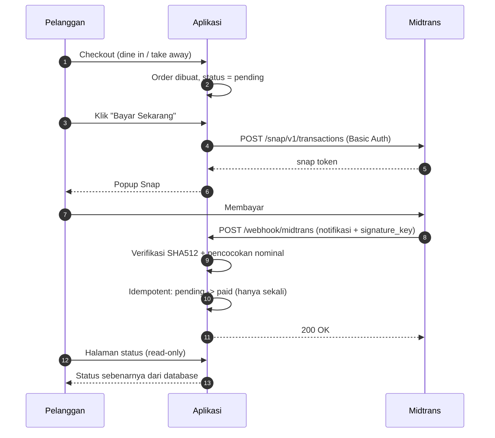

# ☕ Brew & Bean Café — Sistem Pemesanan & Pembayaran Kafe

Aplikasi pemesanan kafe (**Dine In** & **Take Away**) dengan pembayaran
**Midtrans Snap**, dashboard admin, dan **integritas pembayaran berbasis webhook
bersignature**.

> Fokus proyek ini bukan pada jumlah fitur, melainkan pada **ketepatan penanganan
> uang**: status pembayaran tidak bisa dipalsukan dari sisi klien, notifikasi
> Midtrans diproses secara idempotent, dan setiap notifikasi tercatat sebagai
> bukti audit.

---

## Fitur

### Sisi pelanggan
- Katalog menu, dikelompokkan per varian
- Keranjang belanja
- Checkout **Dine In** (wajib nomor meja) atau **Take Away** (wajib nomor HP + jam pengambilan)
- Pembayaran via Midtrans Snap — kartu, bank transfer, e-wallet, QRIS
- Halaman status pesanan

### Sisi admin
- Login khusus admin, dibatasi 5 percobaan per menit
- Dashboard: pesanan hari ini, pendapatan hari ini, jumlah pending/diproses, grafik 7 hari
- Kelola pesanan: filter status & tipe, pencarian, detail, ubah status, hapus
- Kelola produk: CRUD dengan unggah gambar (file maupun URL)

---

## Alur pembayaran



**Halaman sukses tidak menandai pesanan lunas.** Status pembayaran hanya berubah
dari notifikasi Midtrans yang signature-nya terverifikasi.

---

## Keamanan pembayaran

| Kendali | Penerapan |
|---|---|
| Verifikasi signature | `SHA512(order_id + status_code + gross_amount + ServerKey)` dengan `hash_equals()` |
| Idempotency | Guard peta transisi status + `lockForUpdate()` di dalam `DB::transaction` |
| `fraud_status` | `challenge` menahan pesanan tetap `pending`; `deny` membatalkan pesanan |
| Pertahanan berlapis | Setelah signature valid, nominal dibandingkan dengan total pesanan |
| Audit | Tabel `payment_events` mencatat **semua** notifikasi, termasuk yang signature-nya palsu |
| Halaman sukses | Read-only — dikunci oleh `tests/Feature/CheckoutSuccessIsReadOnlyTest.php` |
| Akses halaman bayar | Hanya untuk sesi yang membuat pesanan tersebut |
| CSRF pada webhook | `webhook/midtrans` dikecualikan (notifikasi server-ke-server) |
| Brute force login | `throttle:5,1` pada login admin |

**Jebakan yang sudah ditangani:** `gross_amount` dari Midtrans adalah *string*
(`"36000.00"`). Bila nilai itu di-cast ke angka, representasinya berubah menjadi
`"36000"`, hash tidak pernah cocok, dan **seluruh** notifikasi ditolak. Ada test
khusus untuk menjaga hal ini (`MidtransSignatureTest`).

---

## Stack

- PHP 8.2 · Laravel 12
- SQLite (pengembangan) — skema portabel ke MySQL/PostgreSQL
- Midtrans Snap melalui REST API langsung, diuji dengan `Http::fake()`
- Blade + CSS khusus (`public/css`), Font Awesome, Google Fonts
- PHPUnit 11

---

## Cara menjalankan

```bash
# 1. Dependensi
composer install
npm install

# 2. Environment
copy .env.example .env        # Linux/macOS: cp .env.example .env
php artisan key:generate

# 3. Database + data contoh (2 akun + 16 produk)
php artisan migrate --seed

# 4. Jalankan
php artisan serve
```

Buka http://localhost:8000

### Akun demo

| Peran | Email | Password |
|---|---|---|
| Admin | `admin@brewbean.id` | `admin123` |
| Pelanggan | `test@example.com` | `password` |

> Kredensial di atas hanya untuk pengembangan lokal — ganti sebelum deploy.

---

## Konfigurasi Midtrans (sandbox)

1. Masuk ke [dashboard Midtrans sandbox](https://dashboard.sandbox.midtrans.com) — gratis, tanpa dokumen legal.
2. Ambil **Server Key** dan **Client Key** dari Settings → Access Keys.
3. Isi `.env`:

```env
MIDTRANS_SERVER_KEY=SB-Mid-server-xxxxxxxx
MIDTRANS_CLIENT_KEY=SB-Mid-client-xxxxxxxx
MIDTRANS_IS_PRODUCTION=false
```

4. Untuk menerima webhook saat pengembangan, buka tunnel ke server lokal:

```bash
ngrok http 8000
```

5. Daftarkan URL notifikasi di dashboard Midtrans
   (`Settings → Configuration → Payment Notification URL`):

```
https://<domain-ngrok>/webhook/midtrans
```

6. Uji dengan tombol **Test notification**, atau bayar memakai kartu uji sandbox:
   `4811 1111 1111 1114` (masa berlaku bebas, CVV `123`, OTP `112233`).

---

## Testing

```bash
php artisan test                              # seluruh suite
php artisan test --filter=MidtransWebhook     # hanya webhook
php vendor/bin/pint                           # perapian gaya kode
```

Test berjalan di SQLite **in-memory** dan memigrasi ulang dari nol setiap kali,
sehingga skema selalu terverifikasi terhadap migrasi.

---

## Keputusan desain & trade-off

Bagian yang biasanya ditanyakan saat review, jadi ditulis eksplisit.

**1. Status pembayaran hanya berubah dari webhook, bukan dari halaman sukses.**
Halaman sukses hanyalah bukti pelanggan kembali ke situs — bukan bukti uang diterima.
Sebelumnya `GET /checkout/success/{order}` menandai pesanan lunas, sehingga siapa pun
yang menebak `order_id` (format `ORD-ymd-XXXXX`) bisa melunasi pesanan tanpa membayar.
Perilaku itu kini dikunci oleh test regresi.

**2. `payment_events` dipisahkan dari `orders`.**
Notifikasi Midtrans bisa datang berkali-kali (pengiriman ulang) dan bisa datang untuk
pesanan yang tidak dikenal. Karena itu notifikasi dicatat *append-only* di tabel sendiri,
sehingga status pesanan tetap bersih sementara jejak audit tetap lengkap.

**3. Idempotency lewat peta transisi, bukan `if status === 'pending'`.**
Midtrans mengirim ulang notifikasi yang belum dijawab sukses. Pola `if pending then paid`
rapuh; peta transisi + `lockForUpdate()` membuat notifikasi kedua tidak berefek.

**4. Memakai HTTP client, bukan SDK `midtrans-php`.**
Tiga alasan: bisa diuji penuh dengan `Http::fake()`; tidak memakai state global
(`\Midtrans\Config::$serverKey`) yang bermasalah pada aplikasi async/multi-tenant; dan
hanya satu endpoint (Snap) yang dibutuhkan.

**5. Keranjang disimpan di session, bukan database.**
Pelanggan tidak perlu akun sehingga friction checkout minimal. Konsekuensinya keranjang
hilang bila cookie dibersihkan dan tidak bisa dianalisis untuk *abandoned cart*. Keputusan
ini ditinjau ulang bila fitur akun pelanggan ditambahkan.

**6. Harga disimpan sebagai integer berskala ×100.**
Mencegah galat pembulatan floating point dan memudahkan konversi ke `gross_amount`
Midtrans. Rencana jangka pendek: disederhanakan menjadi integer rupiah, karena IDR
tidak memiliki pecahan (lihat Roadmap).

**7. Akses halaman pembayaran dibatasi sesi, bukan signed URL.**
Menutup kebocoran data (nama, telepon, nomor meja) sekaligus mencegah pembuatan token
pembayaran atas nama orang lain. Trade-off: pelanggan yang berpindah browser kehilangan
akses. Signed URL direncanakan sebagai perbaikan berikutnya.

---

## Struktur proyek

```
app/
├── Enums/OrderStatus.php                    peta transisi status (gerbang idempotency)
├── Http/
│   ├── Controllers/
│   │   ├── MenuController.php               katalog
│   │   ├── CartController.php               keranjang
│   │   ├── CheckoutController.php           alur checkout
│   │   ├── PaymentController.php            pembayaran & halaman status
│   │   ├── MidtransWebhookController.php    satu-satunya penentu status bayar
│   │   └── Admin/                           auth, dashboard, pesanan, produk
│   ├── Middleware/AdminMiddleware.php
│   ── Requests/                            validasi keranjang & checkout
├── Models/                                  Order, Product, PaymentEvent, User
└── Services/
    ├── CartService.php                      satu-satunya sumber total keranjang
    ├── CheckoutService.php                  pembentukan pesanan
    ├── MidtransService.php                  Snap + verifikasi signature
    └── OrderStatusService.php               penerapan notifikasi (idempotent)
database/
├── migrations/                              termasuk payment_events & kolom pembayaran
├── factories/                               User (termasuk state admin), Product, Order
└── seeders/                                 2 akun + 16 produk
tests/
├── Feature/                                 pembayaran, keranjang, webhook, autorisasi
└── Unit/                                    peta transisi status
```

---

## Roadmap

Bagian yang sudah selesai ditandai ✅.

**Fase 1 — Integritas pembayaran & arsitektur** ✅
- [x] Webhook Midtrans bersignature + idempotent
- [x] Menghapus penandaan lunas dari halaman sukses
- [x] `payment_events` sebagai bukti audit
- [x] Pemetaan `transaction_status` + `fraud_status`
- [x] Memecah `CoffeeController` menjadi controller per tanggung jawab
- [x] `CartService`, `CheckoutService`, FormRequest
- [x] `snap.js` mengikuti lingkungan (sandbox/production)
- [x] `throttle` pada login admin
- [x] Suite test (81 test, 236 assertion)

**Fase 2 — Fondasi domain**
- [ ] Normalisasi `orders.items` (JSON) → tabel `order_items` dengan snapshot harga
- [ ] Konversi satuan uang ×100 → integer rupiah (menyentuh `products.price`, `orders.total`, dan `orders.items[*].price`)
- [ ] Tabel `categories`, menggantikan pengelompokan berbasis regex pada nama produk
- [ ] `orders.customer_id` + fondasi RBAC (4 peran)
- [ ] Policy untuk otorisasi per resource
- [ ] Signed URL untuk halaman pembayaran
- [ ] Transition guard pada perubahan status oleh admin

**Fase 3 — Operasional**
- [ ] Inventory + `stock_movements` (dikurangi saat `paid`, bukan saat pesanan dibuat)
- [ ] Kitchen Display System + `order_status_histories`
- [ ] Kasir, antrian pesanan, manajemen meja
- [ ] Queue + scheduler: `ExpireUnpaidOrders`, `SendOrderConfirmation`

**Fase 4 — Manajemen & analitik**
- [ ] Laporan: revenue, AOV, menu terlaris, penjualan per kategori, jam sibuk
- [ ] Analitik pembayaran per `payment_type`
- [ ] Ekspor CSV/Excel/PDF (mulai dari CSV dengan `StreamedResponse`)

**Fase 5 — Lanjutan & pengiriman**
- [ ] Notifikasi real-time (Reverb/WebSocket) + fallback polling
- [ ] REST API + Sanctum + dokumentasi OpenAPI
- [ ] CI: GitHub Actions (test + Pint) dan Larastan
- [ ] Docker + docker-compose
- [ ] Deploy + demo online (Midtrans sandbox)

---

## Catatan jujur

- **Pint masih melaporkan masalah gaya** pada file baru maupun file bawaan (terutama
  `line_ending` CRLF vs LF). Perapian belum dijalankan karena repo ini baru dibuat dan
  reformat massal akan menutupi perubahan bermakna pada commit awal.
- **Webhook belum diuji end-to-end ke Midtrans asli.** Feature test menembak route secara
  langsung — cara yang benar untuk test — sehingga untuk verifikasi nyata dibutuhkan
  Server Key sandbox dan tunnel (lihat bagian konfigurasi di atas).
- **Integrasi kanal pihak ketiga lain (mis. GoFood/GoBiz) belum ada.** GoBiz Open API
  bersifat *partner-only* — pendaftaran mandiri tidak tersedia — sehingga integrasi
  semacam itu tidak dapat diwujudkan untuk proyek pribadi dan tidak diklaim di sini.